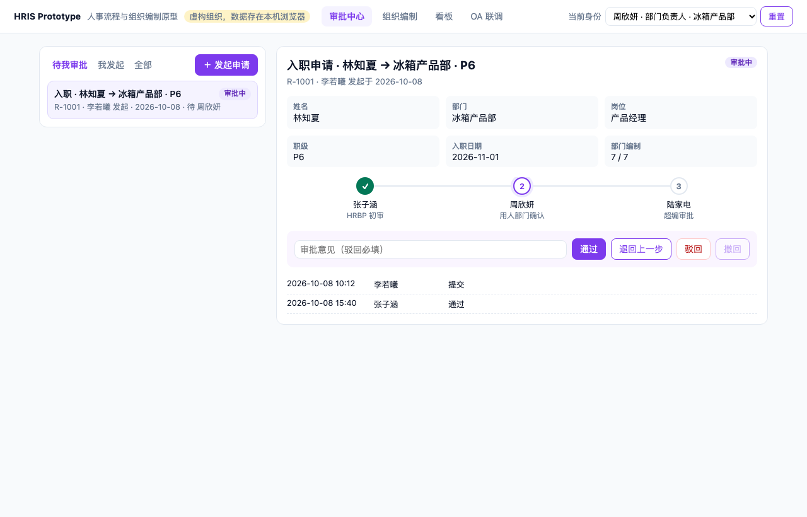
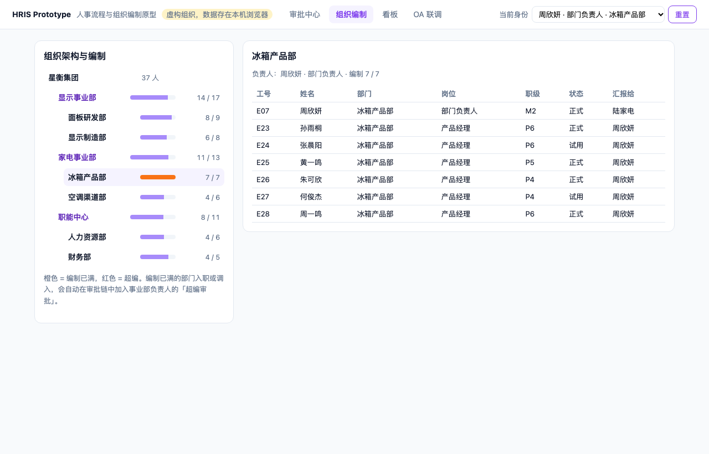
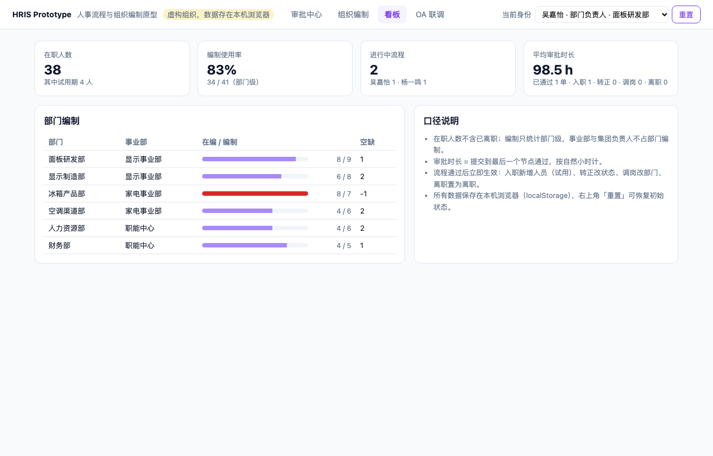
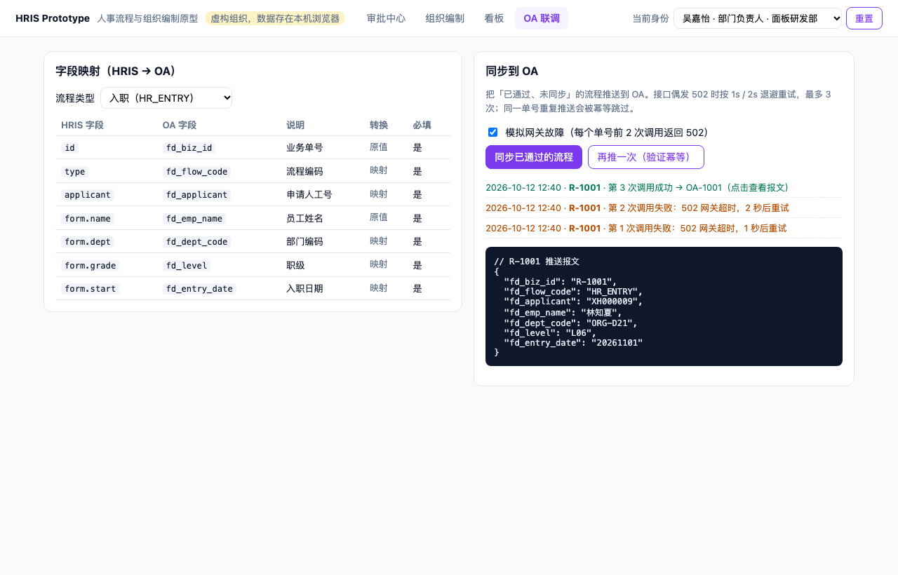
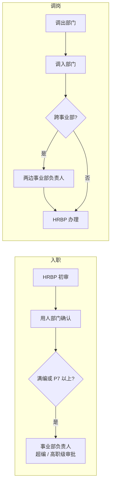

# HRIS Prototype · 人事流程与组织编制原型

**一个能真的点下去的 HR 系统原型：入 / 转 / 调 / 离的审批链按组织和编制实时算出来，审批通过立即改动人员数据，再按字段映射推送到 OA。**

[在线体验](https://annawzhang.github.io/hris-prototype/) · [一键演示完整链路](https://annawzhang.github.io/hris-prototype/?demo#oa) · [浏览器内测试](https://annawzhang.github.io/hris-prototype/tests.html) · 原生 JavaScript，无依赖、无构建

> 组织、人员均为虚构；数据保存在你自己的浏览器（localStorage），右上角「重置」可恢复初始状态。



## 为什么做成可交互原型

静态原型图评审时最常被问的是「这种情况下谁来批？」「批完数据怎么变？」「OA 那边收到什么？」。
这个原型把这三件事做成真实逻辑：右上角切换身份就能以任何审批人的视角操作，审批链随组织与编制实时变化，
OA 报文可以直接打开看。

| 评审时的问题 | 原型里的回答 |
|---|---|
| 这个流程谁来批？ | 审批链按流程类型、部门、职级、编制实时生成；发起申请时就能预览 |
| 部门已经满编了还能进人吗？ | 能，但自动加一个事业部负责人的「超编审批」节点 |
| 跨事业部调岗走几级？ | 调出 / 调入部门 + 两边事业部负责人 + HRBP，共 5 级 |
| 批错了怎么办？ | 支持退回上一步、驳回（必须写原因）、申请人撤回，非当前审批人无法操作 |
| 批完之后呢？ | 立即生效：入职新增试用员工、转正改状态、调岗改部门、离职回收 |
| OA 怎么对接？ | 字段映射表 + 编码转换 + 必填校验；接口 502 时退避重试，重复推送幂等跳过 |

## 四个页面

| 审批中心 | 组织编制 |
|---|---|
|  |  |
| **看板** | **OA 联调** |
|  |  |

## 审批规则



| 流程 | 审批链 |
|---|---|
| 入职 | HRBP 初审 → 用人部门确认 →（满编：超编审批）→（P7 以上：高职级审批） |
| 转正 | 直属上级评估 → HRBP 确认（仅试用期员工可发起） |
| 调岗 | 调出部门 → 调入部门 →（跨事业部：两边事业部负责人）→（调入满编：超编审批）→ HRBP 办理 |
| 离职 | 直属上级确认 → HRBP 面谈 → IT 资产交接 |

- 同一审批人出现在多个节点时合并为一个节点，标签叠加（例如「超编审批 · 高职级审批」）。
- 审批链在提交时生成快照，之后组织变化不影响进行中的流程。
- 同一员工同时只能有一个进行中的流程。
- 部门负责人的直属上级是事业部负责人。

## OA 集成

| 环节 | 规则 |
|---|---|
| 字段映射 | 每种流程一张映射表：工号加前缀补位、部门转 `ORG-` 编码、职级转 OA 枚举、日期转 `yyyyMMdd` |
| 校验 | 必填字段为空或枚举无法映射，直接报错，不发请求 |
| 重试 | 502 时按 1s / 2s 退避，最多 3 次；仍失败进入人工补偿队列 |
| 幂等 | 以业务单号为幂等键，已同步的单号再次推送直接跳过 |

## 本地运行

```bash
python3 -m http.server 8000
# 打开 http://localhost:8000/ ，测试页 http://localhost:8000/tests.html（11 个测试）
```

| 文件 | 作用 |
|---|---|
| `src/data.js` | 虚构组织架构、编制、人员与初始流程 |
| `src/workflow.js` | 审批链生成、状态机、生效逻辑、看板指标、OA 映射与同步（纯函数） |
| `src/app.js` | 界面与交互、本地存储、`?demo` 演示 |
| `tests.html` | 引擎测试，在浏览器中运行 |

## 背景

本项目是作者在 HR 产品实习中所做「HRIS 交互原型 + OA 编排联调」的公开复刻版。原工作用 Axure 做了 20 多套交互原型，
覆盖审批、组织、看板三大模块，并完成 OA 字段映射与接口联调；这里用代码重新实现了同样的业务规则，组织与数据均为虚构。
